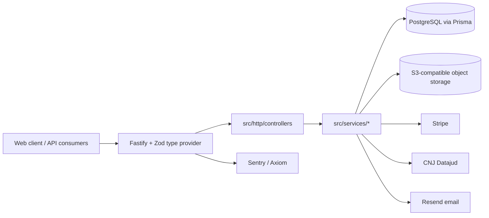

# jurispro-api

Multi-tenant REST API for a Brazilian labor-law settlement calculator and case-management product.

Status: prototype-to-early-product backend; not claimed to be in production. Source shared for portfolio review.

## What it does

- Labor liquidation engine: FGTS, INSS, income tax, interest, monetary correction with a frozen index snapshot per calculation, prescription, court costs, custom line items (`src/services/labor-calculation/`).
- Organizations with roles and visibility rules (multi-seat tenancy), invites and a client portal.
- Case management: notes, hearings, deadlines, agenda, document templates (docx) and generated documents.
- Court docket sync from the public CNJ Datajud API.
- Public calculator, batch assessment, and an API-key protected public API with metered Stripe billing.
- Seat-based Stripe billing, referral program, support tickets with optional ClamAV scan, SSE messaging.

## Architecture



- Controllers validate input with Zod and delegate; business rules live in `src/services/<domain>/`.
- Calculators are pure functions with unit tests, independent of HTTP and the database.
- All environment access goes through the Zod schema in `src/env/index.ts`.

## Key engineering decisions

- Monetary indices are snapshotted per calculation so results do not change when index tables are updated (`src/services/labor-calculation/index-snapshot.ts`).
- Tenancy and role checks are covered by a role matrix test (`src/http/role-matrix.test.ts`).
- Tests refuse to run against a non-test database (`src/tests/helpers/db.ts`).
- CI generates throwaway JWT keys per run instead of committing any (`.github/workflows/ci.yml`).
- Optional integrations degrade explicitly, e.g. attachments are stored with `scanStatus: skipped` when no scanner is configured.

## Tech stack

Node 22, TypeScript, Fastify 5, Zod 4, Prisma 6 (PostgreSQL), Vitest, Biome, Stripe, S3-compatible storage, Resend, Sentry, pnpm.

## Getting started

Prerequisites: Node 22, pnpm 10, PostgreSQL.

```bash
pnpm install
cp .env.example .env     # fill in values
pnpm exec prisma generate
pnpm exec prisma migrate deploy
pnpm dev
```

JWT keys: generate an RSA pair and base64-encode the PEM files into `JWT_PRIVATE_KEY` / `JWT_PUBLIC_KEY` (the CI workflow shows the exact openssl commands).

| Variable | Purpose |
| --- | --- |
| `DATABASE_URL`, `DIRECT_URL` | PostgreSQL connection strings |
| `JWT_PRIVATE_KEY`, `JWT_PUBLIC_KEY` | Token signing pair |
| `CLIENT_URL` | Allowed web client origin |
| `FGTS_RATE`, `MINIMUM_WAGE` | Calculation parameters |
| `R2_*` | Object storage credentials |
| `STRIPE_*` | Billing (optional) |
| `RESEND_API_KEY`, `FROM_EMAIL`, `SUPPORT_EMAIL` | Email (optional) |
| `SENTRY_DSN`, `AXIOM_*` | Observability (optional) |
| `GOOGLE_*` | Calendar integration (optional) |

See `.env.example` for the full list.

## Testing

114 test files (Vitest). Run `pnpm test` with a `.env.test` pointing to a disposable PostgreSQL database.

## Project structure

```text
src/http/controllers/   HTTP layer per aggregate
src/services/           domain logic and calculators
src/env/                validated environment
prisma/                 schema and migrations
```

## License

All rights reserved. Source available for portfolio review.
