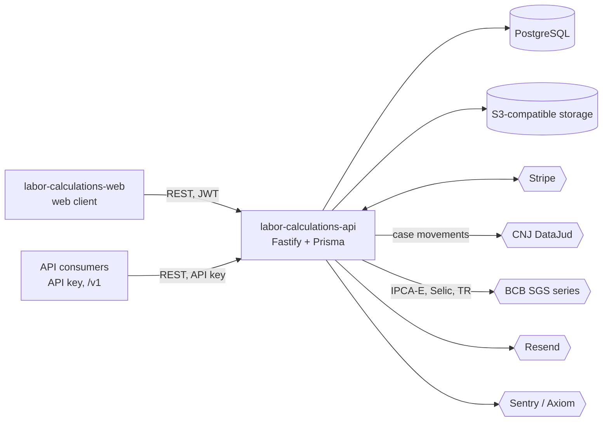
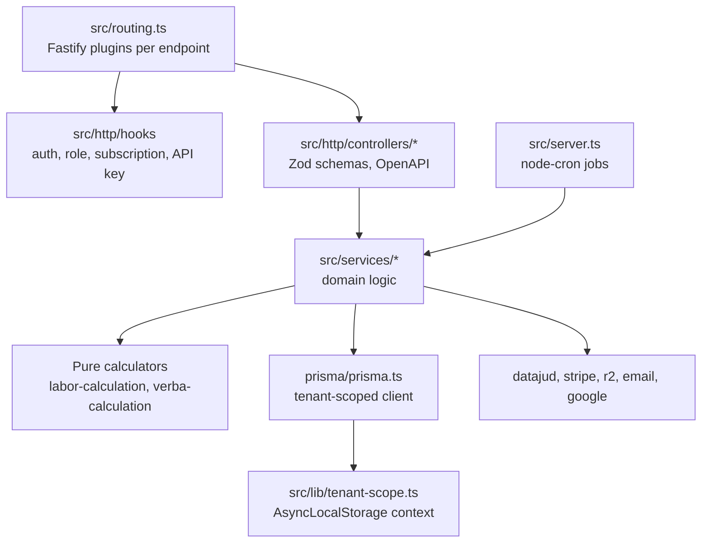
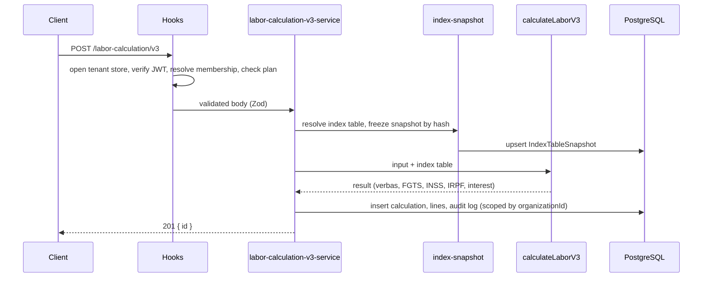

# labor-calculations-api

Multi-tenant REST API that computes Brazilian labor-claim settlements (liquidação de sentença) and manages the law-firm case workflow around them, including court docket sync from DataJud.

**Status:** prototype-to-early-product backend. Not claimed to be in production use; the repository shows no users or revenue. Source is shared for portfolio review.

## What it does

- Labor liquidation engine: FGTS, INSS, income tax (IRPF), interest, monetary correction, prescription, court costs, overtime, vacation and 13th salary, salary differences and custom line items (`src/services/labor-calculation/`, `src/services/verba-calculation/`).
- Reproducible results: the monetary index table used by each calculation is frozen as a deduplicated snapshot, and re-indexing is an explicit action.
- Organizations with five roles (owner, admin, lawyer, staff, intern), visibility rules, invites and a client portal.
- Case management: parties, tasks, hearings, deadlines, notes, fee agreements, agenda, docx templates and generated documents.
- Court docket sync from the public CNJ DataJud API for labor-court case numbers (`src/services/datajud/`).
- Public self-service calculator, batch assessment, and an API-key protected `/v1` calculation API with metered Stripe billing.
- Seat-based Stripe billing, referral program, support tickets with optional ClamAV scan, scheduled reminders.

## Architecture

System context (the web client is a sibling repository):



Layers inside this repository:



Main flow, creating a calculation:



Data model (50 Prisma models in `prisma/schema.prisma`), main entities:

- Identity and tenancy: `User`, `Organization`, `Membership`, `Invite`, `RefreshToken`, `ApiKey`.
- Calculation: `LaborCalculation` with `FgtsMonthlyEntry`, `CalculationVerbaLine`, `SalaryHistory`, `CustomVerba`, `IndexTableSnapshot`, `MonetaryIndex`, `Settlement`.
- Case workflow: `Client`, `Case`, `CaseMovement`, `Hearing`, `Deadline`, `Document`, `DocumentTemplate`, `Message`.
- Commercial: `Subscription`, `ApiUsage`, `Referral`, `PublicCalculation`, `BatchAssessment`, `SupportTicket`.

Boundaries:

- Controllers validate input with Zod and delegate; rules live in `src/services/<domain>/`.
- Calculators are pure functions with unit tests, independent of HTTP and the database.
- All environment access goes through the Zod schema in `src/env/index.ts`.
- Provider code (DataJud, Stripe, R2, email) stays in its own service folder or `src/lib`.

## Key engineering decisions and trade-offs

- Tenant isolation is enforced below the controllers: a Prisma client extension injects `organizationId` into every query of tenant models and rejects raw SQL under a tenant context (`prisma/prisma.ts`, `src/lib/tenant-scope.ts`, `src/lib/tenant-context.ts`). Cross-tenant access goes through an explicit `systemPrisma`. Trade-off: background jobs must enter a tenant context on purpose.
- Monetary indices are snapshotted per calculation so a total does not change when index tables are updated (`src/services/labor-calculation/index-snapshot.ts`). Trade-off: re-indexing is a deliberate step (`reindex-calculation-service.ts`).
- Index tables are synced from the public BCB SGS series (`src/services/monetary-index/sync-monetary-indices.ts`).
- DataJud sync maps a CNJ number to the labor-court index alias and ignores other justice segments (`src/services/datajud/datajud-service.ts`).
- Role and tenancy rules are covered by a role matrix test (`src/http/role-matrix.test.ts`) and tenant-coverage tests (`src/lib/tenant-context-coverage.test.ts`).
- Tests refuse to run against a non-test database (`src/tests/helpers/db.ts`); CI creates throwaway JWT keys per run (`.github/workflows/ci.yml`).
- Optional integrations degrade explicitly, for example attachments are stored with `scanStatus: skipped` when no scanner is configured.

## Tech stack

Node 22, TypeScript, Fastify 5, Zod 4, Prisma 6 (PostgreSQL), Vitest, Biome, Stripe, S3-compatible storage, Resend, Sentry, Axiom, node-cron, pnpm, tsup.

## Getting started

Prerequisites: Node 22, pnpm 10, PostgreSQL.

```bash
pnpm install
cp .env.example .env     # fill in values
pnpm exec prisma generate
pnpm exec prisma migrate deploy
pnpm dev
```

JWT keys: generate an RSA pair and base64-encode the PEM files into `JWT_PRIVATE_KEY` and `JWT_PUBLIC_KEY` (the CI workflow shows the exact openssl commands).

| Variable | Purpose |
| --- | --- |
| `DATABASE_URL`, `DIRECT_URL` | PostgreSQL connection strings |
| `JWT_PRIVATE_KEY`, `JWT_PUBLIC_KEY` | Token signing pair |
| `CLIENT_URL` | Allowed web client origin |
| `FGTS_RATE`, `MINIMUM_WAGE` | Calculation parameters |
| `R2_*` | Object storage |
| `DATAJUD_API_KEY` | DataJud docket sync (optional) |
| `STRIPE_*` | Billing (optional) |
| `RESEND_API_KEY`, `FROM_EMAIL`, `SUPPORT_EMAIL` | Email (optional) |
| `SENTRY_DSN`, `AXIOM_*` | Observability (optional) |
| `CLAMAV_HOST` | Attachment scanning (optional) |
| `GOOGLE_*` | Calendar integration (optional) |

See `.env.example` for the full list.

## Testing

114 test files and roughly 860 `it`/`test` cases (Vitest). Run `pnpm test` with a `.env.test` pointing to a disposable PostgreSQL database; the script applies migrations first. The CI workflow (`.github/workflows/ci.yml`) runs typecheck, lint and tests against a Postgres service.

## Project structure

```text
src/http/controllers/   HTTP layer per aggregate
src/http/hooks/         auth, roles, subscription, API key
src/services/           domain logic and calculators
src/lib/                tenant scope, storage, Stripe, observability
src/env/                validated environment
prisma/                 schema and migrations
```

## Related repositories

- `labor-calculations-web`: web client for this API.

## License

All rights reserved. Source available for portfolio review.
